<p align="center">
  
</p>

<p align="center">
  <a href="https://purpleheads2026.github.io/Mod_claude/"><b>▶&nbsp;Live demo</b></a>
  &nbsp;·&nbsp;
  <a href="#install">Install</a>
  &nbsp;·&nbsp;
  <a href="#anatomy-of-the-radar">Reading the radar</a>
  &nbsp;·&nbsp;
  <a href="#how-the-motion-works">How the motion works</a>
</p>

**Regia** is Italian for *control room*, the booth a live broadcast is run from. It is a plugin for [Claude Code](https://claude.com/claude-code) that adds a panel to the desktop app's Code tab and shows, in real time, what your session is doing: the subagents at work, the skills loaded, every tool call, how full the context is and how much of your usage window is left.

Everything moves at the speed of the session: tool calls are born on the radar's needle and sweep around as they age, subagents orbit the core while they work, and gauges grow from their last reading to the new one.

## The panel

<p align="center">
  
</p>

| Monitor | What it shows |
| --- | --- |
| **Radar** | The main session at the core, with status, turn timer and context ring. Subagents orbit it as satellites, and the last 60 seconds of tool calls run around the rim. |
| **Agents** | One card per subagent, with the same monogram as its satellite. Each card shows status, elapsed time, the model and a strip of the tools it called. |
| **Instruments** | Context in use, your 5-hour usage limit, output tokens, what fills the context and every usage window with its reset time. |
| **Skills** | Every skill loaded in the session and how often. The ones loaded this turn are highlighted. |
| **Activity** | One lane per agent over the last five minutes. The lanes scroll with time. |
| **Tools** · **Files** | The tools you lean on most, and every file read or edited. |

The panel follows your system's *reduce motion* setting: movement stops and only the fading of old tracks remains. In a terminal session Regia draws a compact text version instead.

## Anatomy of the radar

<p align="center">
  
</p>

- **Now**: the needle at twelve o'clock. Every tool call starts there and sweeps clockwise at 6° a second, so its angle is its age.
- **Tool tracks**: one ring per agent, with the main session on the outside. Colour is the kind of tool (read, write, shell, web, agents, skills, MCP), and tracks fade out over 60 seconds.
- **Satellites**: subagents in fixed slots, in the order they were born, so none jumps around. A dashed beam flows to each one while it works; it pops in when it starts and sends out a ring when it finishes.
- **The core**: *on air* or *standby*, the turn timer, and a ring for how full the context window is.

## Install

You need Claude Code **2.1.293 or later**; older builds, such as 2.1.233, do not load function-hook plugins. Check with:

```bash
claude --version
```

This repository is a plugin marketplace: the plugin is `regia` and the marketplace is `mod-claude`.

### From a terminal session

At the Claude Code prompt, type:

```
/plugin install regia --marketplace purpleheads2026/Mod_claude
```

Answer `y` to add the marketplace, then pick the **user** scope.

The `/plugin` command is not available in the desktop app's Code tab. A plugin installed from a terminal at user scope loads in desktop sessions too, as long as both use the same configuration profile: if the app uses its own folder, export the same `CLAUDE_CONFIG_DIR` before launching `claude`.

### With the CLI

```bash
claude plugin install regia --marketplace purpleheads2026/Mod_claude --scope user
```

### From a local clone (best if you want to tinker)

```bash
git clone https://github.com/purpleheads2026/Mod_claude.git
```

```bash
claude plugin marketplace add "$PWD/Mod_claude"
```

```bash
claude plugin install regia@mod-claude --scope user
```

With a local marketplace Claude Code reads the plugin straight from the folder, so after a `git pull` or an edit a `/reload-plugins` is enough. `claude plugin list` shows where it is read from (`Read from:`).

## Using it

- **New sessions** load Regia on their own and open the panel at start, if there is room.
- **Sessions already open**: run `/reload-plugins`, or close and reopen the session.
- **Open the panel** at any time with `/regia`.

In the panel, **Compact / Expand** switches between the radar, agents and skills only and the full panel. **Reset stats** clears calls, agents, skills and files for the session; context and limits stay. While subagents are working, the status line reads *Regia · N agents running*.

## Language

The panel speaks English by default and Italian on request. To switch:

```bash
echo '{"language":"it"}' | claude plugin configure regia@mod-claude --values-stdin
```

Use `"en"` to switch back. Open sessions pick it up after `/reload-plugins` or a restart.

## Update and uninstall

When installed from GitHub:

```bash
claude plugin marketplace update mod-claude
```

```bash
claude plugin update regia@mod-claude
```

With a local clone, `git pull` and `/reload-plugins` in open sessions are enough. To uninstall:

```bash
claude plugin uninstall regia@mod-claude
```

## How the motion works

Each monitor is a self-contained SVG. The panel redraws it every second while Claude is working, and every redraw replaces the whole document. That would normally restart every animation from zero. Regia avoids this by tying every animation to the wall clock with a negative `animation-delay`:

- an **event** animation, such as a satellite popping in, is delayed by minus its age, so one that started 5 seconds ago is already finished and one that started 100 ms ago resumes from there;
- a **loop**, such as the radar sweep or a beam's flow, is delayed by minus `now mod period`, so every loop stays in phase across redraws.

Tool tracks are drawn at absolute angles (`time mod 60 s`) inside a group that rotates at 6°/s. On screen, a track's angle is always its age.

Two more rules came out of testing on the real desktop app:

- **Rendering is deterministic.** The panel never reads the live clock while drawing, only the timer's last beat or the latest recorded event. The engine redraws the pane on every scroll and every click, and if the SVGs changed each time, image swaps would nudge the scroll position and trigger yet another redraw.
- **Monitors are images.** The desktop shows interactive SVGs in a 150 px high frame, so every monitor is drawn as an image instead.

## Development

The code map, with what each file does, how they connect and the rendering rules, is in [overview.md](overview.md) (in Italian).

```bash
claude plugin validate regia
```

```bash
claude plugin test regia
```

Preview with fake data, including a live simulated session:

```bash
node regia/preview/build.mjs
```

Then serve `regia/preview/` with any static server and open `live.html?w=400` (add `&lang=it` for Italian). The README images and the demo page are generated from the plugin's own code:

```bash
node scripts/showcase.mjs
```
